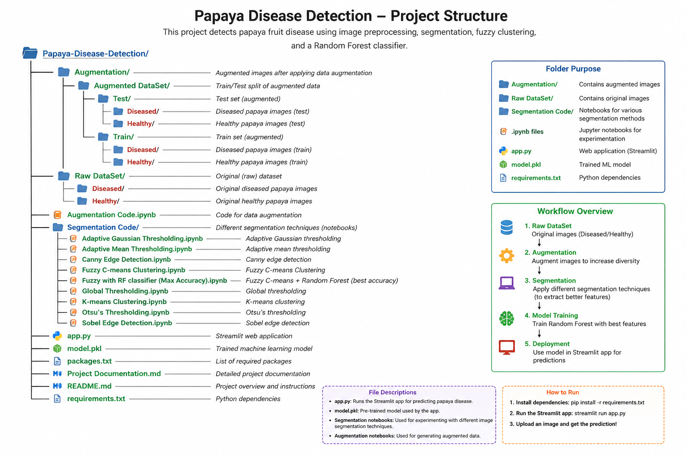

# Papaya Fruit Disease Detection

A machine learning system that classifies papaya fruit images as **Healthy** or **Diseased** using classical computer vision segmentation techniques combined with supervised machine learning classifiers.

## Overview

Manual inspection of papaya fruit for disease is time-consuming and error-prone. This project builds an automated, image-based classification pipeline that can flag diseased fruit from a photograph, with the goal of supporting faster and more consistent quality checks for farmers and agronomists.

The project explores eight different image segmentation techniques paired with seven different classifiers, compares them systematically, and deploys the best-performing pipeline as an interactive web application.

## Dataset

- 1,000 original images (500 Healthy, 500 Diseased)
- Augmented via flips (horizontal, vertical, both) and rotations (90°, 180°, 270°) - 7 versions per original image
- **Train/test split is performed on original images before augmentation**, and each original's augmented versions are kept together on one side of the split. This prevents data leakage that would otherwise occur if augmented copies of the same source image ended up in both the training and test sets.

## Methodology

### Segmentation techniques evaluated
1. Global Thresholding
2. Otsu's Thresholding
3. Adaptive Mean Thresholding
4. Adaptive Gaussian Thresholding
5. Canny Edge Detection
6. Sobel Edge Detection
7. K-Means Clustering
8. Fuzzy C-Means Clustering

### Classifiers evaluated
1. Decision Tree
2. Naive Bayes
3. Logistic Regression
4. K-Nearest Neighbors (KNN)
5. Random Forest
6. Voting Classifier (Soft Voting)
7. Voting Classifier (Hard Voting)

Each segmentation technique is paired with each classifier, and evaluated using accuracy, precision, recall, and F1-score on a held-out test set (not just overall accuracy, given class imbalance between Healthy and Diseased samples).

### Feature pipeline
- Images are converted to grayscale, denoised with a Gaussian blur, segmented using the technique under test, resized to 64x64, and flattened into a 1D feature vector.
- For Fuzzy C-Means, cluster membership values are used as additional engineered features alongside raw pixel intensities, rather than as a substitute for ground-truth labels, this keeps the classifier's target aligned with the actual Healthy/Diseased label rather than the clustering's own unsupervised output.
- All features are scaled with `MinMaxScaler`, fit on the training set only and applied to the test set, to keep distance-based methods (Fuzzy C-Means, KNN, Logistic Regression) well-behaved.

### Fruit-region cropping
An earlier version of the pipeline was found to rely on border/background pixels rather than the fruit surface itself when making predictions (confirmed via Random Forest feature importance mapping). To address this, images are now cropped to the detected fruit boundary (via contour detection on an Otsu-thresholded mask) before further processing, so the model is trained on the fruit surface rather than incidental background or framing cues.

## Best-performing pipeline

The combination of **Fuzzy C-Means segmentation** and **Random Forest classification** is packaged as a single scikit-learn `Pipeline` object, bundling:
- Fruit-region cropping and preprocessing
- MinMaxScaler normalization
- Fuzzy C-Means feature extraction
- Random Forest classification

This is saved as a single `.pkl` file for deployment, so no separate scaler/model objects need to be tracked or loaded independently.

## Deployment

The trained pipeline is deployed as an interactive Streamlit web application. Users can upload a papaya image and receive:
- A Healthy/Diseased prediction with confidence score
- Per-class probability breakdown

## Project structure




## Running the app locally

```bash
pip install streamlit opencv-python scikit-learn scikit-fuzzy scikit-image joblib matplotlib

streamlit run app.py
```

Then open the local URL shown in the terminal and upload a papaya image.

## Results

Metrics are reported per segmentation-classifier combination (accuracy, precision, recall, F1-score, confusion matrix), evaluated on a properly held-out test set. Fuzzy C-Means + Random Forest was selected as the deployed pipeline based on this comparison.


## Known limitations and future work

- The current pipeline uses classical, hand-crafted features (segmentation + flattened pixel intensities). A CNN-based approach (e.g. transfer learning with MobileNet or EfficientNet) is a natural next step, particularly since color information is discarded in the current grayscale pipeline and may carry disease-relevant signal that pixel intensity alone does not capture.
- The dataset originates from a limited number of source images under relatively controlled photography conditions (uniform background, studio lighting). Performance on real-world field photographs (variable background, lighting, and camera quality) has not yet been validated and is expected to be lower.
- Multi-class classification (identifying specific diseases rather than a binary Healthy/Diseased label) is a planned extension.
- Explainability could be extended further with Grad-CAM or similar techniques once a CNN-based model is introduced, complementing the current Random Forest feature-importance analysis.
